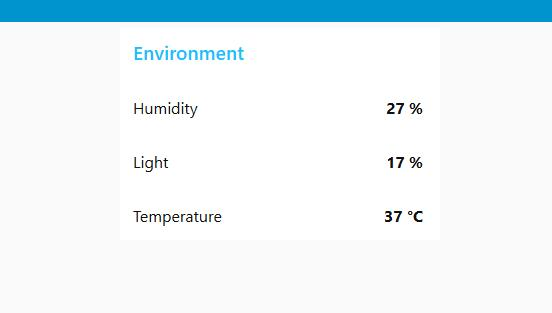

# STM32 Environmental Telemetry to Node-RED

[简体中文](README.zh-CN.md)

An STM32F103ZE reads a DHT11 temperature and humidity sensor and a light-sensitive ADC input. It controls an ESP8266 over a dedicated UART, packages the readings as JSON and posts them to a Node-RED server over Wi-Fi.

**What worked.** The coursework report recorded repeated uploads to Node-RED. Its dashboard screenshot shows **37 °C, 27% relative humidity and 17% light** for one historical sample. The importable flow in this repository was also independently checked with valid input, invalid input and a query before the first reading.

~~~mermaid
flowchart LR
    D["DHT11 and light input"] --> M["STM32F103ZE"]
    M -->|USART2 / AT commands| W["ESP8266 Wi-Fi"]
    W -->|HTTP POST /sensor| N["Node-RED validate and show latest sample"]
~~~

The screenshot is from the original coursework dashboard. The [current importable flow](node-red/flows.json) uses stock Node-RED nodes. It exposes the latest reading over HTTP and in the Debug sidebar. See [wiring, request format and setup](docs/bring-up.md) and the [sanitized firmware entry point](firmware-example/main.c).
