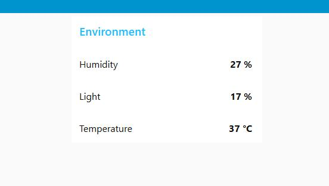

# STM32 环境数据采集与 Node-RED

[English](README.md)

项目使用 STM32F103ZE 读取 DHT11 温湿度和光敏 ADC 输入，再通过独立串口控制 ESP8266，将 JSON 数据经 Wi-Fi 上传至 Node-RED。

**实际效果。** 课程报告记录了 Node-RED 连续接收多次上报。原始仪表盘截图显示其中一次读数为 **37 °C、相对湿度 27%、相对光照 17%**。本仓库可导入的流程也已单独通过有效数据、错误数据和空记录查询测试。

~~~mermaid
flowchart LR
    D["DHT11 与光敏输入"] --> M["STM32F103ZE"]
    M -->|USART2 与 AT 指令| W["ESP8266 Wi-Fi"]
    W -->|HTTP POST /sensor| N["Node-RED 校验并显示最新采样"]
~~~

截图来自课程原始仪表盘。[当前可导入流程](node-red/flows.json)使用 Node-RED 基础节点，通过 HTTP 和 Debug 侧栏提供最新读数。参见[接线、数据格式与部署步骤](docs/bring-up.zh-CN.md)及[脱敏固件入口](firmware-example/main.c)。
